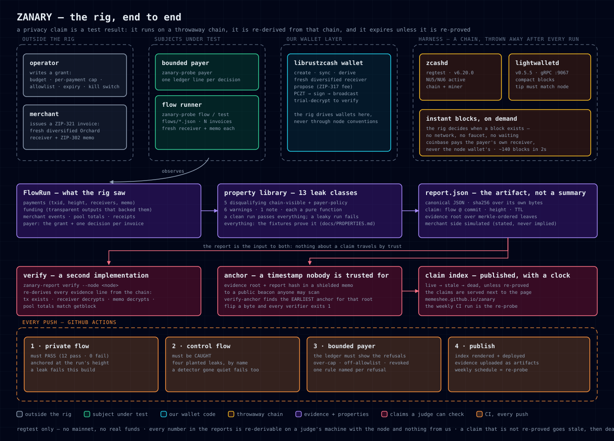

# ZANARY

**Privacy claims should be falsifiable.** ZANARY is an independent prober for Zcash payment flows: it
runs a flow with real shielded transactions on a throwaway chain, proves or breaks each privacy claim
with reproducible evidence, and publishes claims that **expire** unless someone re-proves them.

Built for **ZECATHON** (Core & Tooling track), by kiter + Hermes.

[](https://github.com/memeshee/zanary/actions/workflows/privacy-gate.yml)
— two flows per push: one that must pass, one that must be **caught**. Both jobs green means the rig
worked, not that nothing was found; open the control job's summary for the leaks it caught.

**▶ [The two-minute demo](https://memeshee.github.io/zanary/video/)** — one real run: the private flow
passing, the deliberately leaky control flow being **caught**, the bounded payer's ledger refusing
over-cap, off-allowlist and revoked invoices, and the published claims with their expiry clocks
([cut sheet](docs/VIDEO-SCRIPT.md)).

**▶ [Audited, and fixed](#audited-and-fixed)** — the rig's own standard, applied to the rig: an
independent read-only audit of revision `7058406` returned 19 findings, and the section below says which
**7 a leak class could have caught**, why the other **12 are the shape of the product**, and what each fix
was. The full record, row by row with every guarding test named, is
[`docs/WHAT-IT-CAUGHT.md`](docs/WHAT-IT-CAUGHT.md).



> **On the name:** this project ran as *CANARY* until Oct 15, 2026 and is **ZANARY** since. Evidence
> recorded before the rename — `crates/report/fixtures/`, the claim rows in `docs/LEAK-MATRIX.md` —
> is kept byte-identical, because editing a recorded run invalidates the hashes that make it
> checkable. New runs carry ZANARY's flow ids (`zanary-checkout*`).

> Status: **in build** (Oct 11 → Oct 28, 2026). What runs today is listed under *What works now* —
> nothing below claims more than the code does. The README is updated as phases land; the
> "real vs mocked" section is the contract, not decoration.

---

## The problem

Every Zcash integration is asked the same question by its users: *"does this actually preserve
privacy, or does it only look like it does?"* Today the answer is a paragraph in a README, a screenshot,
or an audit that costs more than the app. Meanwhile the failure modes are structural and boring —
a transparent fallback nobody noticed, one receiver reused across invoices, a wallet quietly told to
`AllowRevealedAmounts`, amounts that echo a funding deposit so the round trip is linkable by amount and
timing alone.

The Zcash ecosystem funds audits, privacy research and formal verification, but a payment flow still
has **no executable privacy test**: nothing a developer can run in CI that fails the build when the
flow starts leaking.

## What ZANARY is

1. **A rig** — one command brings up a disposable Zcash chain (instant blocks, no sync, no faucet) and
   an indexer; flows execute against it with real shielded transactions.
2. **A property library** — each leak class is a named test with a severity, a detection method and
   evidence a stranger can check: ([`docs/PROPERTIES.md`](docs/PROPERTIES.md)).
3. **An adversarial profiler** — the rig acts as the attacker: it tries to cluster the flow's payments
   into a payer graph and reports the confidence it achieved, next to a control flow that must *not*
   cluster.
4. **A report you can verify without trusting the rig** — `report.json` with txids, receivers, memos
   and heights; hashed, with the root anchored in a shielded memo so the evidence is publicly
   timestamped without revealing who ran it.
5. **A gate you can put in CI** — one command (`zanary-probe test <flow>`), one exit code: `0` the run
   matched its expectation and the chain agrees, `1` a flow leaked or a control flow the library was
   supposed to bite was not caught, `2` the rig itself could not check. The workflow in this repo runs
   a private flow and a deliberately leaky control side by side, and uploads the evidence
   ([`docs/CI.md`](docs/CI.md)).
6. **A claim index with expiry** — a public page per claim (`flow × property`, verified-at-height, TTL,
   evidence). Re-proved on a schedule or it goes stale, then dead. *A privacy claim is not a fact, it
   is a subscription.*
7. **A reference subject that passes** — a bounded payer given a *budget instead of a key* (per-payment
   cap, receiver allowlist, expiry, kill switch), which the rig tests with the same library it uses on
   anyone else: the twelve chain-visible properties plus `payer-policy`, which reads the payer's ledger
   and fails when a payment broke the grant ([`docs/BOUNDED-PAYER.md`](docs/BOUNDED-PAYER.md)).

## What works now

| Piece | State |
|---|---|
| Disposable chain + indexer (`harness/`) | **works** — zcashd v6.20.0 regtest + lightwalletd v0.5.5, one `docker compose up -d`, 140 blocks in ~2 s |
| Seeding + evidence script (`harness/seed.sh`) | **works** for chain + shielded-memo payments (node-wallet path retired — see `harness/HARNESS.md`) |
| Our own Rust client over the chain | **works** — `zanary-probe` connects to the indexer, reports chain/version/tip via `GetLightdInfo` + `GetLatestBlock` |
| librustzcash wallet (create → sync → receiver → balance) | **works** — `zanary-probe wallet`, `address --transparent/--orchard` (see `docs/WALLET-NOTES.md`) |
| Shielded send path — fund → shield → pay with a ZIP-302 memo | **works** — `zanary-probe fund/shield/pay`, all built/proved/signed in our code, txids + before/after balances + recipient-side memo read in `docs/WALLET-SEND-NOTES.md` |
| Flow runner — one command, real evidence | **works** — `zanary-probe flow --definition flows/checkout-private.json` executes N invoices (fresh diversified receiver + ZIP-302 memo each, verified by a separate merchant wallet), then writes `run.json` + `findings.json` + `report.json`; the private flow scores 12 pass / 0 fail, the control flow fails by design (`docs/FLOW-RUNNER-NOTES.md`) |
| Batched settlement — N invoices, one transaction | **works** — `settlement: "batch"` puts every invoice in one transaction (one txid, one fee, shuffled output order, a distinct amount per invoice enforced before anything is built) and reads each payment back at the merchant by amount + memo; `flows/checkout-private-batch.json` scores 11 pass / 1 fail — the failure is `payer-linkability`, because a batch links its own invoices by construction (`docs/THREAT-MODEL.md`) |
| Signed receipts, verified offline | **works** — each receipt is signed by a *dedicated receipt key* (ZIP-32 account 1 of the merchant seed), never the wallet's own spend authority, and the wallet **attests** that key with its own signature; `zanary-report verify-receipt` checks the receipt with no node, no indexer and no rig (proven with both pointed at dead ports), and `--fvk` binds receipt key → wallet through the attestation — a receipt published without it is bound to no wallet, which is the point |
| Leak matrix | **works** — `zanary-report matrix --runs <dir> --out docs/LEAK-MATRIX.md`: **13 properties × 7 runs**, each column pinned to its `flow_commit` — two clean private flows, the batch that discloses its own `payer-linkability`, the control's four designed failures, both CI flows, and the bounded payer (where `payer-policy` is the only property with a ledger to read) |
| Agent payment loop | **works** — `scripts/agent-pay-loop.sh`: three invoice → pay → verify cycles unassisted, with the merchant's own wallet reading each memo back (invoices 8101–8103, txids in `docs/FLOW-RUNNER-NOTES.md`) |
| Anchored reports — a claim with a chain timestamp | **works** — `zanary-probe anchor --report <report.json>` puts the report's `evidence_root` + `report_hash` in a shielded memo to a public beacon, and `zanary-report verify-anchor` finds the earliest anchor for that root with a node and the beacon's *published* viewing key, nothing from ZANARY (640 blocks / 693 txs in ~3 s); unanchored reports, flipped roots, disagreeing `--root`s and post-hoc edits all exit 1 (`docs/ANCHOR-NOTES.md`) |
| CI gate — one command, an exit code a build can read | **works** — `zanary-probe test --definition <flow.json> --expect pass\|fail [--anchor] [--summary <path>]` runs the flow, re-derives every evidence line from the chain, anchors the evidence root in a shielded memo, prints the claim (height, report hash, expiry) and exits `0`/`1`/`2`; the two CI flows score `12 pass · 0 fail` (private, `4d8279bb`) and `4 fail` (control — the planted leaks, caught) and the GitHub Action runs both on every push ([`docs/CI.md`](docs/CI.md), [`.github/workflows/privacy-gate.yml`](.github/workflows/privacy-gate.yml)) |
| Claim index with expiry, published | **works** — `zanary-report index --reports <dir> --out <index.html>` renders one page per claim with `live`/`stale`/`dead`/`regression` against a clock, each claim's anchor, and a link to the claim's own `report.json`/`anchor.json` so a reader can re-derive the row; CI renders and deploys it on every push and weekly re-probe, next to the claims themselves: **<https://memeshee.github.io/zanary/>** ([`docs/CI.md`](docs/CI.md), golden fixture: [`crates/report/fixtures/index.golden.html`](crates/report/fixtures/index.golden.html)) |
| The reference implementation that passes — a bounded payer | **works** — `zanary-probe payer --grant <grant.json> --invoices <dir>`: a budget, a per-payment cap, a receiver allowlist, an expiry and a kill switch, with one ledger line per decision (`paid`/`refused` + the rule), appended as the run progresses and read back at startup, so a re-run refuses what it already paid. The grant semantics are strict: the budget counts what paying costs (principal + the per-payment fee), the expiry is compared as an instant, and one invoice id is one decision. Recorded: 4 invoices → 1 paid, 3 refused (budget, cap, allowlist), `payer-policy` PASS, and a kill-switch run where all 4 are refused. `--expect-refused N` makes the refusal set itself a test ([`docs/BOUNDED-PAYER.md`](docs/BOUNDED-PAYER.md)) |

## Audited, and fixed

This repository was audited the way it audits payment flows: a read-only hunter/verifier run against
revision `7058406`, with every finding reproduced in a `--network=none` disposable copy before it was
reported, then re-checked by a second agent that read neither the finding nor its author's claim. It
returned **19 findings — 11 confirmed (4 medium, 7 low) and 8 leads, 0 rejected**. Every confirmed
finding is fixed on `main` with a regression test named after it; every lead is either closed against
the running rig or named with the fact it still needs. Tests went **67 → 89** across the audit
(`cargo test --workspace`, 0 failures). The record — findings, traces, reproductions, the coverage
ledger, the budget, and what the audit did *not* cover — is in [`audit/`](audit/README.md).

### The half of it a leak class could not have caught

Nineteen findings invites the wrong question (*"is this a list of defects?"*). The useful one is **which
of them could a leak class in this library have caught in a flow run?** — because the answer is the
boundary of what a flow prober can prove. Of the 19, **7 sit inside a class this library names** and
**12 do not**. The 12 are not a gap in the coverage ledger; they are the shape of the product: a checker
that watches a payment flow is blind, by construction, to the tool around the flow. This section is the
short form — [`docs/WHAT-IT-CAUGHT.md`](docs/WHAT-IT-CAUGHT.md) is the row-by-row record, with every fix's
guarding test named and the command that re-derives each count.

**Inside (7).** The top three rows are one failure mode wearing three hats — *the rule and the check
encoded the same wrong assumption, so a run that should have failed passed, with evidence attached.* No
amount of extra property coverage finds that: a property is only as right as its definition of the leak.

| finding | class | what the check could not see | fix (each carries a test named after the finding) |
| --- | --- | --- | --- |
| `payer-budget-excludes-fees` | `payer-policy` | "budget" meant invoice principal in the *rule* **and** in the *property*, so the fee that paying costs was invisible to both | the fee is part of the budget rule and of the property; the grant carries a cardinality bound |
| `payer-expiry-text-compare` | `payer-policy` | the property compared the same expiry text the rule did, so an expiry written with a UTC offset still paid | instants compared; an unreadable expiry fails closed; `decided_at` recorded |
| `payment-record-pool-legs-and-policy-are-constants-not-derived` | `payer-policy`, `policy-downgrade`, `unshielding` | the record the properties read claimed `Orchard → Orchard · Shielded · FullPrivacy` for **every** payment, because those fields were literals | `pool_out`, `kind` and `policy` derived from the receiver address; a value that would land outside Orchard is refused before any money moves, with a ledger line naming the pool |
| `payer-duplicate-invoice-id-replay` | `payer-policy` | invoice identity was a label, not a key: two files carrying one `invoice_id` were both paid, and the duplicated ledger passed the property | ids deduped in decision order; txids attributed by position; ledger replay refused |
| `payer.rs:run:unbounded-payment-count` | `payer-policy` | the grant bounded the sum of amounts, not how many payments the authority covers | cardinality bound in the grant and in the property; intake capped (1024 files, 64 KiB each) |
| `payer-ledger-not-durable` | `payer-policy` | a run killed mid-flight left on-chain payments with no ledger, and a re-run would pay them again | the ledger is appended and flushed per decision; a replay is refused, not paid again (verified under SIGKILL) |
| `published-summary-carries-invocation-paths` | `report-leak` | published claim files carried the gate's absolute invocation paths — the class whose job is *an exported report reveals more than the claim it supports*, applied to us | the gate's summary records workspace-relative paths |

**The finding that says the observation can lie.** The third row is the sharpest thing the audit found,
because it attacks what this repository sells: *evidence*. The property was right about the record; the
record was wrong. A payment to a Sapling receiver would have been recorded as Orchard→Orchard and scored
clean. The fix derives the pool legs from the receiver address and refuses — before any money moves,
naming the pool it would have crossed — a receiver whose value would leave Orchard: verified on the
running rig, an allowlisted transparent receiver is refused while the Orchard invoice under the same
grant is paid. The **flow runner's** records were deliberately left exactly as they were: rewriting how
it records would change the bytes of reports whose hashes are in claims already published. A tidier
record is worth less than a re-derivable one.

**Outside (12), by the kind of check that actually catches them.** None of these needs a leak class; all
of them needed someone reading the code as a tool rather than as a flow.

| what it is | n | what catches it |
| --- | --- | --- |
| a tool reading a file someone else wrote | 4 | hostile-input handling, per call site — truncating untrusted JSON by byte index, non-ASCII hex, a multi-byte txid, `u64` amounts summed unchecked — each one a panic, which is no verdict at all |
| a verifier certifying what it did not check | 1 | the verifier's own test suite: `verify-receipt` accepted a receipt whose claims merely *embedded* the body's figures by substring |
| resources a stranger controls | 3 | bounds taken from metadata, before the work — a FIFO or symlink stalling the run, unbounded intake memory ahead of any authority check, a definition asking for 2³²−1 mined blocks per payment |
| the plumbing around the rig | 3 | reading the plumbing: composite-action inputs expanded into shell script text, the rig that produces every published claim running from mutable `:latest` images, the control plane and indexer published on every interface behind credentials the public repository carries |
| still open | 1 | a human, for now — nothing machine-checks what the demo video's pixels say ([`audit/run-1/NEEDS-VALIDATION.md`](audit/run-1/NEEDS-VALIDATION.md)) |

All 8 leads were closed on the fixed code — the rig-dependent ones by re-running them against the live
harness ([`audit/README.md`](audit/README.md) § *Verified against the running rig*) — except the open one
above, which is named rather than papered over.

Every row here is re-checkable. [`docs/WHAT-IT-CAUGHT.md`](docs/WHAT-IT-CAUGHT.md) carries this split row
by row, all 14 guarding test names, and the command that re-derives each count;
[`audit/run-1/findings.json`](audit/run-1/findings.json) carries the 19 findings with their evidence;
[`audit/run-1/coverage-ledger.json`](audit/run-1/coverage-ledger.json) names the 20 coverage units and the
7 the budget did not fund. The 7/12 line is a judgment call, drawn by the rule that page states —
relabel a row and the count moves, which is why every row also carries its fix.

## How it fits the track

Core & Tooling: "Build something the next Zcash developer will thank you for. SDKs, explorers,
**testing tools**, better integrations. Solve a problem you wish someone already had solved."
ZANARY is a testing tool that answers the event's own first judging criterion — *does it actually
preserve privacy; leaks are disqualifying* — with a run instead of a claim.

**Not to be confused with** (stated because naming neighbours is cheaper than being accused of
ignoring them):
- **Tells** — diagnoses a wallet's *existing history* (round trips, quick exits, fingerprint amounts).
  ZANARY tests a flow's *future behaviour*, before users are exposed.
- **Zcash Selected-Payment Receipts SDK** — *discloses* one payment minimally, from the Orchard
  outgoing cipher key. ZANARY *tests* implementations, and can test this format's verifier.
- **ZAP1 (`@frontiercompute/zcash-mcp`)** — attestations about Zcash *workflows*; a receipt of state,
  not a payment-privacy test.

## Running it

```bash
# the whole story in one command: private flow PASS, control flow CAUGHT, bounded payer's ledger,
# claim index — every stage allowed to fail, and reported if it does
harness/up.sh && scripts/demo-run.sh

# or the pieces, one at a time:
harness/up.sh                             # throwaway chain + indexer, and wait until they are usable
cargo build --release --bin zanary-probe --bin zanary-report

# the whole point, in one command: run a flow, verify it against the chain, anchor it, judge it
./target/release/zanary-probe test --definition flows/ci-checkout.json --expect pass \
    --anchor --ttl-days 30 --summary data/runs/ci/test.json

# and the other half of the pair: this one must be caught
./target/release/zanary-probe test --definition flows/ci-checkout-control.json --expect fail

# the subject: a bounded payer — a budget instead of a key, with the ledger the rig then checks
./target/release/zanary-probe payer --grant data/grants/payer-pass.json \
    --invoices data/invoices/payer-pass --out data/runs/payer-pass --expect-refused 3
```

Requirements: Docker, Rust (stable, ≥ 1.88 — the Zcash stack refuses older toolchains), ~3 GB RAM free.
Full harness notes, traps, and evidence: [`harness/HARNESS.md`](harness/HARNESS.md).

## Real vs mocked

- The chain is **real** (a real Zcash node in regtest mode, real shielded transactions, real memos) and
  **local** — no mainnet funds are used or needed.
- Wallets in the rig are **ours**, built on librustzcash; the node is only the chain and the miner.
- Anything simulated (for example a merchant endpoint the rig runs itself) is labelled as such in the
  report, and the property it exercises is stated in plain words.

## Limits, stated up front

- The local chain's shielded pool tops out at Orchard/NU6 (Ironwood is a Zebra-era pool); the rig tests
  **property classes** that are pool-independent, and the documented Zebra/Zaino route for real-network
  runs lives in [`harness/HARNESS.md`](harness/HARNESS.md).
- Network-layer deanonymisation and protocol soundness are out of scope (`docs/PROPERTIES.md`).
- Fees on real networks (~5000 zat/action) make sub-dollar payments uneconomic — a rig finding that
  affects what a flow *should* do, not what it can do.

## Licence

MIT (see `LICENSE` when it lands with the first public push).
